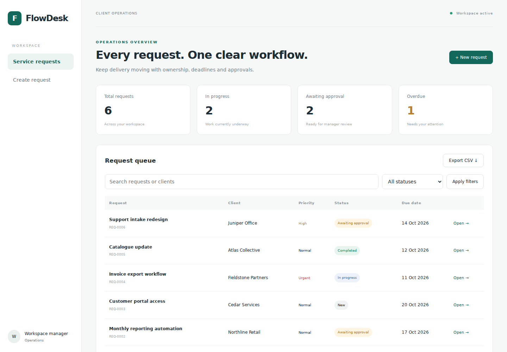
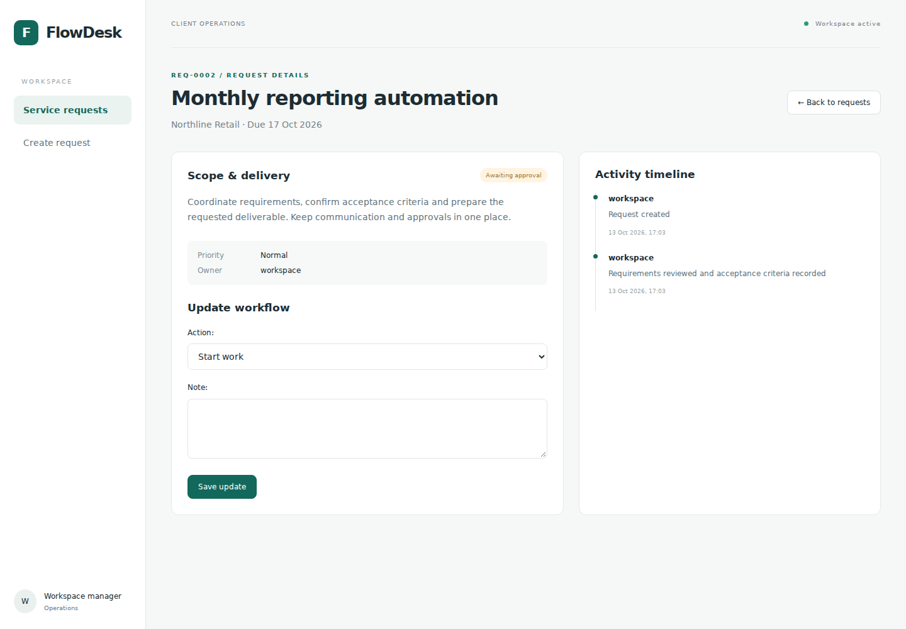
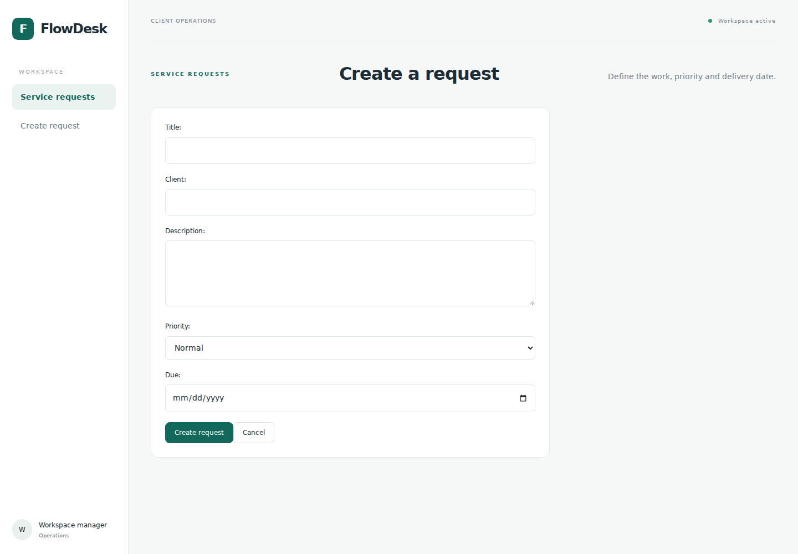

# FlowDesk — Service Request & Approval Portal

## The problem

Service teams need a reliable way to track requests, deadlines and approval handoffs without losing decisions across messages.

## The solution

FlowDesk brings a searchable request queue, priorities, ownership and manager approval into one workspace. Users create requests, record notes, move work through permitted states and review chronological activity.

- Authenticated access and owner-scoped records
- New → In progress → Awaiting approval → Completed
- Manager-only completion approval
- Request validation, deadlines and status filtering
- Persistent storage and CSV exports

## Screenshots

## Explore the implementation

[Models](app/core/models.py) · [Workflow rules](app/core/services.py) · [Tests](app/core/tests.py) · [Run locally](SETUP.md)

The screenshots use illustrative service requests and fictional company names. This is a personal project, not a client engagement. This repository page is a source walkthrough, not a live hosted application.
